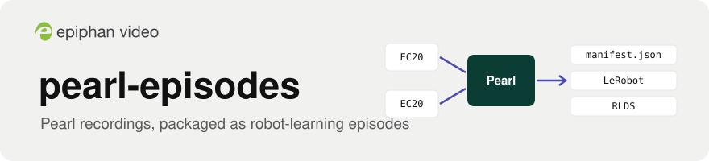
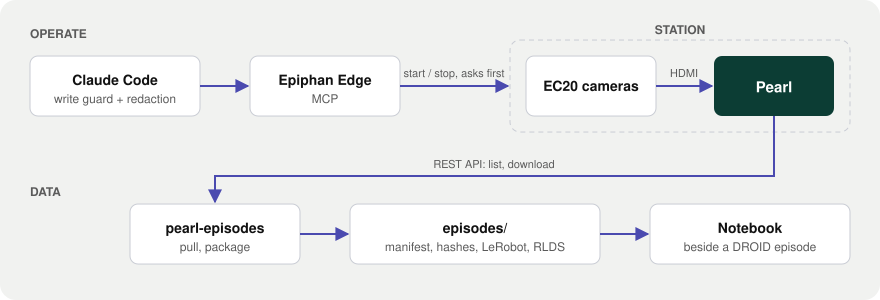

<p align="center">
  <picture>
    <source media="(prefers-color-scheme: dark)" srcset="docs/assets/banner-dark.svg">
    
  </picture>
</p>

<p align="center">
  <a href="https://github.com/ScientiaCapital/pearl-episodes/actions/workflows/ci.yml"></a>
  
  
</p>

<p align="center">
  <a href="#what-you-get-one-take-one-episode">What you get</a> ·
  <a href="#quick-start">Quick start</a> ·
  <a href="docs/HARDWARE.md">PoC station</a> ·
  <a href="SECURITY.md">Security</a>
</p>

# pearl-episodes

Record robot-learning demonstrations on **Epiphan Pearl**, run the capture stations from one screen through
**Epiphan Edge**, and package every take as an episode in the formats robotics labs already train on:
**LeRobot**, and **RLDS** as used by Open X-Embodiment.

Robot-learning labs record demonstrations at fixed stations: a robot arm, one to four cameras, and a person
driving the arm. The common rig, [DROID](https://droid-dataset.github.io/), was "replicated 18 times" across 13
institutions, many of them campuses that already run Pearl. Their recording stack is USB cameras into a
workstation running open-source software. This project tests whether an independent, remotely operated
recording layer beside that rig earns its place, and makes its output load in the lab's own tools.

> **Status: early.** The pipeline runs end to end on test patterns. `pull`, `package` and the LeRobot v3.0
> export are built and tested, and a notebook opens an episode beside DROID. Nothing has run against a real
> Pearl take, a lab or more than one device yet. See [Status](#status).

## What it does

| Layer | What happens | State |
|---|---|---|
| **Operate** | Claude Code drives Epiphan Edge over MCP: check storage and status, start and stop recording across channels, with an approval prompt before every change | Guarded and tested; session script not built |
| **Pull** | List a recorder's files over the Pearl REST API and download them | `list`, `recorders` and `pull` work. Pull skips files already pulled and never leaves a partial file |
| **Package** | One episode per take: original files untouched, one joined video per camera made by remux, `manifest.json` with what the product doesn't record (task, operator, scene, clock source), `hashes.txt` | Built. A take is an explicit list of file ids |
| **Export** | LeRobot v3.0 layout and RLDS, keeping Pearl's H.264 as-is (no re-encode) | LeRobot v3.0 built and opens with LeRobot's own loader. RLDS is next |
| **Analyze** | Open a Pearl episode in the same notebook as a DROID episode | Built (`notebooks/pearl_beside_droid.ipynb`) |

## What you get: one take, one episode

Two EC20s record a take on the Pearl Mini PoC station. `pearl-episodes` packages it into one folder:

```text
episodes/2026-10-14_pick-cup_0007/
├── manifest.json     what the product doesn't record: task, operator, scene, clock source, hashes
├── hashes.txt        sha256 of every file, in `shasum -a 256 -c` format
├── source/           the Pearl's original MP4s, untouched, one folder per channel
├── joined/           one video per camera, segments joined by remux (no re-encode)
├── lerobot/          LeRobot v3.0 layout, Pearl's H.264 kept as-is
└── rlds/             RLDS episode for Open X-Embodiment tools          (planned)
```

This `manifest.json` was written by the real packager (`EpisodeManifest` → `package()`) from stand-in files.
The serial, hashes and tool version are placeholders:

```json
{
  "schema_version": 2,
  "episode_id": "2026-10-14_pick-cup_0007",
  "device_serial": "TEST-SERIAL-0001",
  "device_model": "Pearl Mini",
  "firmware": "4.24.6",
  "start_time": "2026-10-14T10:02:11",
  "cameras": [
    {
      "channel_id": "1",
      "channel_name": "exterior-left",
      "segments": [
        {
          "seq": 0,
          "file_id": "7",
          "path": "source/1/7.mp4",
          "created": "2026-10-14T10:02:11",
          "duration": 62,
          "size": 34,
          "sha256": "4f0fa1c6809e040b17201a56d6dcb73b2f1556508f4feffc88d12dd9f6fc8ba7",
          "recorder_id": "1",
          "event_id": null
        }
      ]
    },
    {
      "channel_id": "2",
      "channel_name": "exterior-right",
      "segments": [
        {
          "seq": 0,
          "file_id": "7",
          "path": "source/2/7.mp4",
          "created": "2026-10-14T10:02:11",
          "duration": 62,
          "size": 34,
          "sha256": "5829f04dacf71219e1191c65719896a7b46dc0d9dbf3434a8663c6cc8942d2f1",
          "recorder_id": "2",
          "event_id": null
        }
      ]
    }
  ],
  "derived": [
    {
      "path": "joined/1.mp4",
      "sha256": "fa643730bb51bc03d96befaa27a0fe261d66ef589a1b94b03eaa97ce4afd247c",
      "tool": "ffmpeg",
      "version": "9.0.2"
    },
    {
      "path": "joined/2.mp4",
      "sha256": "0ece4cd34a71c47aad12c4dc16bb7d0601d70ac4a2634f0248de6f30a19793b9",
      "tool": "ffmpeg",
      "version": "9.0.2"
    }
  ],
  "session_id": null,
  "incidents": [],
  "task_label": "pick up the cup and place it in the bin",
  "operator": "op-02",
  "scene": "bench-desk",
  "clock_source": "ntp",
  "notes": ""
}
```

Then the episode opens in the same notebook as a DROID episode (`notebooks/pearl_beside_droid.ipynb`), which is
the demo for a lab.

## What a station records, plainly

- **Color video only.** Pearl records H.264, 4:2:0, 8-bit (Pearl Nano also H.265). LeRobot stores its color
  streams as `yuv420p` too; its copy of DROID is AV1 4:2:0 at 320×180.
- **No depth.** LeRobot keeps depth as 12-bit lossless, which an 8-bit 4:2:0 stream can't carry. Depth and robot
  state stay on the lab's own stack.
- **No claim about timing or alignment** between cameras or devices. The manifest records each device's
  `clock_source` (NTP, PTP or unknown) and nothing more.
- **Independent views.** The PoC station is a Pearl Mini with two EC20 cameras on HDMI, on the same cart as the
  lab's rig ([docs/HARDWARE.md](docs/HARDWARE.md)). It records the workspace beside the lab's cameras and does not
  replace or copy their feeds.

## How it fits together

<p align="center">
  <picture>
    <source media="(prefers-color-scheme: dark)" srcset="docs/assets/architecture-dark.svg">
    
  </picture>
</p>

| Path | What it is |
|---|---|
| `src/pearl_episodes/pearl/client.py` | Async Pearl REST client: recorders, status, archive listing, atomic download, bulk start/stop |
| `src/pearl_episodes/episodes/manifest.py` | The episode manifest (schema 2) and SHA-256 hashing |
| `src/pearl_episodes/episodes/pull.py` | `pull`: new files for one recorder, idempotent on file id |
| `src/pearl_episodes/episodes/packager.py` | Packages a take: originals, joined video per camera, `manifest.json`, `hashes.txt` |
| `src/pearl_episodes/media/ffmpeg.py` | ffprobe and lossless remux wrappers |
| `src/pearl_episodes/export/lerobot_v3.py` | LeRobot v3.0 export |
| `src/pearl_episodes/config.py` | Settings from `.env` (`PEARL_*`); the password is a `SecretStr` |
| `src/pearl_episodes/cli.py` | `doctor`, `recorders`, `list`, `pull`, `package`, `export` |
| `notebooks/pearl_beside_droid.ipynb` | A Pearl episode beside a DROID episode (outputs cleared) |
| `scripts/make_synthetic_take.py`, `scripts/codec_compare.sh` | A test-pattern take for demos; the bench codec test commands |
| `.claude/settings.json`, `.claude/hooks/` | Edge write guard, redaction and secrets hooks for Claude Code |
| `docs/ARCHITECTURE.md` | The verified REST surface, manifest fields, rules, open product questions |
| `docs/HARDWARE.md` | The bench and the PoC station, with kb.epiphan.com sources |
| `.claude/PLAN.md` | The design: one episode on disk, segment stitching, the operator session, build order |

## Quick start

Needs macOS or Linux, [uv](https://docs.astral.sh/uv/), `jq` (for the Claude Code hooks), and `ffmpeg` with
`ffprobe` (for `package`, `export` and the tests).

```bash
git clone https://github.com/ScientiaCapital/pearl-episodes.git && cd pearl-episodes
uv sync --group dev
uv run pytest -q                 # unit tests, no network
bash tests/hook-test.sh          # guard, redaction and secrets hooks
uv run python scripts/make_synthetic_take.py demo   # a test-pattern take, packaged and exported; no device
cp .env.example .env             # one Pearl's host and admin password
uv run pearl-episodes doctor     # environment and settings check
uv run pearl-episodes recorders  # id, name, multisource
uv run pearl-episodes list 1     # files on recorder 1
uv run pearl-episodes pull 1     # new files into recordings/<host>/1/
uv run pearl-episodes package --camera 1 "Wide Cam" 1 7,8 --serial <serial> --model "Pearl Mini" \
  --firmware <version> --task "pick up the cup"
uv run pearl-episodes export episodes/<episode_id>
```

The serial number comes from Edge, because the REST API does not report it. A bench Pearl with a self-signed
certificate needs `PEARL_VERIFY_TLS=false` in `.env`. TLS is verified by default. `uv sync --extra datasets`
adds LeRobot 0.6.1, TensorFlow, TFDS, matplotlib and JupyterLab; they are large and installed on purpose.

## Working with Claude Code and Epiphan Edge

The `epiphan` MCP server in `.mcp.json` connects Claude Code to Epiphan Edge. In this folder:

- The 20 Edge read tools run without a prompt. **Every write asks first** (recording, streaming, events,
  presets, reboot, firmware), under any connector name, and bypass mode is off. Unknown Edge tools ask too.
- Stream keys, passwords and credentialed URLs are **masked** before the model sees a tool result. Output that
  can't be checked is withheld.
- File writes that contain a key, token, private key or a filled-in `PEARL_PASSWORD` are **denied**.
- The DEV and STAGING connectors and the CRM connector are **denied** here.
- `EPIPHAN_READ_ONLY=1 claude` blocks every Edge write outright.

The write guard and redaction hooks come unchanged from the
[Epiphan Edge Claude Kit](https://github.com/ScientiaCapital/epiphan-edge-claude-kit), and the redaction cases are
shared byte-for-byte with [Fleetwatch](https://github.com/ScientiaCapital/fleetwatch). Edge's sign-in has no
read-only scope, so the token can do whatever its account can: use a least-access Edge account. The trust
model and known limits are in [SECURITY.md](SECURITY.md).

Project commands: `/begin`, `/status`, `/build`, `/ship`, `/end` (`.claude/commands/`).

## Data handling

Recordings, episodes and session logs are gitignored (root-anchored), as are media and dataset files anywhere
in the tree. They may show people, they belong to the lab that produced them, and they stay on the machine they
were pulled to. Internal documents are linked from [docs/context/README.md](docs/context/README.md), never
committed.

## Development

```bash
uv run pytest -q
bash tests/hook-test.sh
uv run ruff check . && uv run ruff format --check .
uvx pre-commit run --all-files   # adds gitleaks, shellcheck, actionlint, zizmor
```

CI runs lint, tests on Linux and macOS, the hook and permission tests, and a gitleaks scan of the full history
on every push and PR. Python 3.12+, async for all I/O, type hints on every function, `ruff` clean. Rules for
contributors and AI assistants are in [CONTRIBUTING.md](CONTRIBUTING.md) and [AGENTS.md](AGENTS.md).

## Status

- **Works:** the REST client, checked against Epiphan's OpenAPI spec and the kb REST pages; `doctor`,
  `recorders`, `list` and `pull`; packaging by remux with manifest v2; the LeRobot v3.0 export, which opens in
  LeRobot's own loader; the DROID side-by-side notebook; the Claude Code safety hooks. All of it is tested with
  generated clips and mocked transports.
- **Next:** a bench session on the Pearl Mini with a first real take, real fixtures, a codec test and USB
  cameras. Then the RLDS export and the operator session script.
- **Not yet run:** against a real Pearl take, against a lab, or against more than one device.
- **Open product questions** are listed in [docs/ARCHITECTURE.md](docs/ARCHITECTURE.md); the code doesn't guess
  at them.

## License

Copyright 2026 Epiphan Systems Inc. All rights reserved. Confidential and proprietary; see [LICENSE](LICENSE) and
[NOTICE](NOTICE) for third-party components. Epiphan, Epiphan Edge, Pearl and EC20 are trademarks of Epiphan
Systems Inc.
