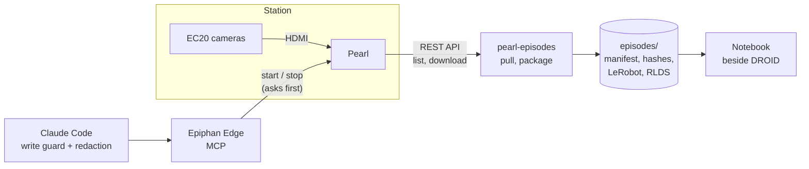

<p align="center">
  <a href="https://github.com/ScientiaCapital/pearl-episodes/actions/workflows/ci.yml"></a>
  
  
</p>

# pearl-episodes

Record robot-learning demonstrations on **Epiphan Pearl**, run the capture stations from one screen through
**Epiphan Edge**, and package every take as an episode in the formats robotics labs already train on:
**LeRobot**, and **RLDS** as used by Open X-Embodiment.

Robot-learning labs record demonstrations at fixed stations: a robot arm, one to four cameras, and a person
driving the arm. The common rig, [DROID](https://droid-dataset.github.io/), was "replicated 18 times" across 13
institutions, many of them campuses that already run Pearl. Their recording stack is USB cameras into a
workstation running open-source software. This project tests whether an independent, remotely operated
recording layer beside that rig earns its place, and makes its output load in the lab's own tools.

> **Status: early.** `doctor` and `list` work against one Pearl. The REST client, the episode manifest and
> SHA-256 hashing exist and are tested. `pull`, `package` and the LeRobot/RLDS exports are next. Nothing has
> run against a lab. See [Status](#status).

## What it does

| Layer | What happens | State |
|---|---|---|
| **Operate** | Claude Code drives Epiphan Edge over MCP: check storage and status, start and stop recording across channels, with an approval prompt before every change | Guarded and tested; session script not built |
| **Pull** | List a recorder's files over the Pearl REST API and download them | `list` works; `pull` next |
| **Package** | One episode per take: original files untouched, `manifest.json` with what the product doesn't record (task, operator, scene, clock source), `hashes.txt` | Manifest and hashes built; take grouping next |
| **Export** | LeRobot layout and RLDS, keeping Pearl's H.264 as-is (no re-encode) | Designed (`.claude/PLAN.md`) |
| **Analyze** | Open a Pearl episode in the same notebook as a DROID episode | Planned |

## What a station records, plainly

- **Colour video only.** Pearl records H.264, 4:2:0, 8-bit (Pearl Nano also H.265). LeRobot stores its colour
  streams as `yuv420p` too; its copy of DROID is AV1 4:2:0 at 320×180.
- **No depth.** LeRobot keeps depth as 12-bit lossless, which an 8-bit 4:2:0 stream can't carry. Depth and robot
  state stay on the lab's own stack.
- **No claim about timing or alignment** between cameras or devices. The manifest records each device's
  `clock_source` (NTP, PTP or unknown) and nothing more.
- **Independent views.** The PoC station is a Pearl Mini with two EC20 cameras on HDMI, on the same cart as the
  lab's rig ([docs/HARDWARE.md](docs/HARDWARE.md)). It records the workspace beside the lab's cameras and does not
  replace or copy their feeds.

## How it fits together



| Path | What it is |
|---|---|
| `src/pearl_episodes/pearl/client.py` | Async Pearl REST client: recorders, archive listing, download, bulk start/stop |
| `src/pearl_episodes/episodes/manifest.py` | The episode manifest model and SHA-256 hashing |
| `src/pearl_episodes/episodes/packager.py` | Writes `manifest.json` and `hashes.txt` for an episode |
| `src/pearl_episodes/config.py` | Settings from `.env` (`PEARL_*`); the password is a `SecretStr` |
| `src/pearl_episodes/cli.py` | `doctor`, `list`; `pull` and `package` are stubs |
| `.claude/settings.json`, `.claude/hooks/` | Edge write guard, redaction and secrets hooks for Claude Code |
| `docs/ARCHITECTURE.md` | The verified REST surface, manifest fields, rules, open product questions |
| `docs/HARDWARE.md` | The bench and the PoC station, with kb.epiphan.com sources |
| `.claude/PLAN.md` | The design: one episode on disk, segment stitching, the operator session, build order |

## Quick start

Needs macOS or Linux, [uv](https://docs.astral.sh/uv/), and `jq` (for the Claude Code hooks).

```bash
git clone https://github.com/ScientiaCapital/pearl-episodes.git && cd pearl-episodes
uv sync --group dev
uv run pytest -q                 # unit tests, no network
bash tests/hook-test.sh          # guard, redaction and secrets hooks
cp .env.example .env             # one Pearl's host and admin password
uv run pearl-episodes doctor     # environment and settings check
uv run pearl-episodes list 1     # files on recorder 1 (ids come from GET /recorders)
```

A bench Pearl with a self-signed certificate needs `PEARL_VERIFY_TLS=false` in `.env`. TLS is verified by
default. `uv sync --extra datasets` adds LeRobot, TensorFlow and TFDS; they are large and installed on purpose.

## Working with Claude Code and Epiphan Edge

The `epiphan` MCP server in `.mcp.json` connects Claude Code to Epiphan Edge. In this folder:

- The 20 Edge read tools run without a prompt. **Every write asks first** (recording, streaming, events,
  presets, reboot, firmware), under any connector name, and bypass mode is off. Unknown Edge tools ask too.
- Stream keys, passwords and credentialed URLs are **masked** before the model sees a tool result. Output that
  can't be checked is withheld.
- File writes that contain a key, token, private key or a filled-in `PEARL_PASSWORD` are **denied**.
- The DEV and STAGING connectors and the CRM connector are **denied** here.
- `EPIPHAN_READ_ONLY=1 claude` blocks every Edge write outright.

The write guard and redaction hooks come unchanged from the
[Epiphan Edge Claude Kit](https://github.com/ScientiaCapital/epiphan-edge-claude-kit), and the redaction cases are
shared byte-for-byte with [Fleetwatch](https://github.com/ScientiaCapital/fleetwatch). Edge's sign-in has no
read-only scope, so the token can do whatever its account can: use a least-access Edge account. The trust
model and known limits are in [SECURITY.md](SECURITY.md).

Project commands: `/begin`, `/status`, `/build`, `/ship`, `/end` (`.claude/commands/`).

## Data handling

Recordings, episodes and session logs are gitignored (root-anchored), as are media and dataset files anywhere
in the tree. They may show people, they belong to the lab that produced them, and they stay on the machine they
were pulled to. Internal documents are linked from [docs/context/README.md](docs/context/README.md), never
committed.

## Development

```bash
uv run pytest -q
bash tests/hook-test.sh
uv run ruff check . && uv run ruff format --check .
uvx pre-commit run --all-files   # adds gitleaks, shellcheck, actionlint, zizmor
```

CI runs lint, tests on Linux and macOS, the hook and permission tests, and a gitleaks scan of the full history
on every push and PR. Python 3.12+, async for all I/O, type hints on every function, `ruff` clean. Rules for
contributors and AI assistants are in [CONTRIBUTING.md](CONTRIBUTING.md) and [AGENTS.md](AGENTS.md).

## Status

- **Works:** `doctor`; `list` against one Pearl; the REST client (verified against Epiphan's OpenAPI spec and the
  kb REST pages); the manifest and hashing; the Claude Code safety hooks.
- **Next:** client hardening (response checks, verified downloads), `pull`, `package` with manifest v2, the
  LeRobot export and the DROID side-by-side notebook, then a bench codec test on the PoC station.
- **Not yet run:** against a lab, against more than one device, or with an RLDS export.
- **Open product questions** are listed in [docs/ARCHITECTURE.md](docs/ARCHITECTURE.md); the code doesn't guess
  at them.

## License

Copyright 2026 Epiphan Systems Inc. All rights reserved. Confidential and proprietary; see [LICENSE](LICENSE) and
[NOTICE](NOTICE) for third-party components. Epiphan, Epiphan Edge, Pearl and EC20 are trademarks of Epiphan
Systems Inc.
